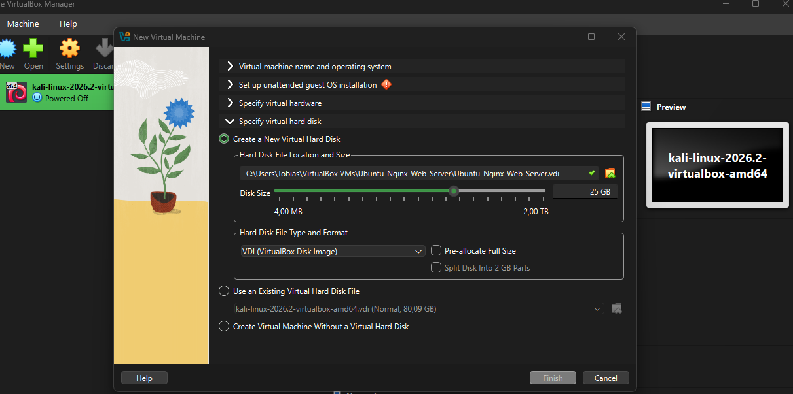
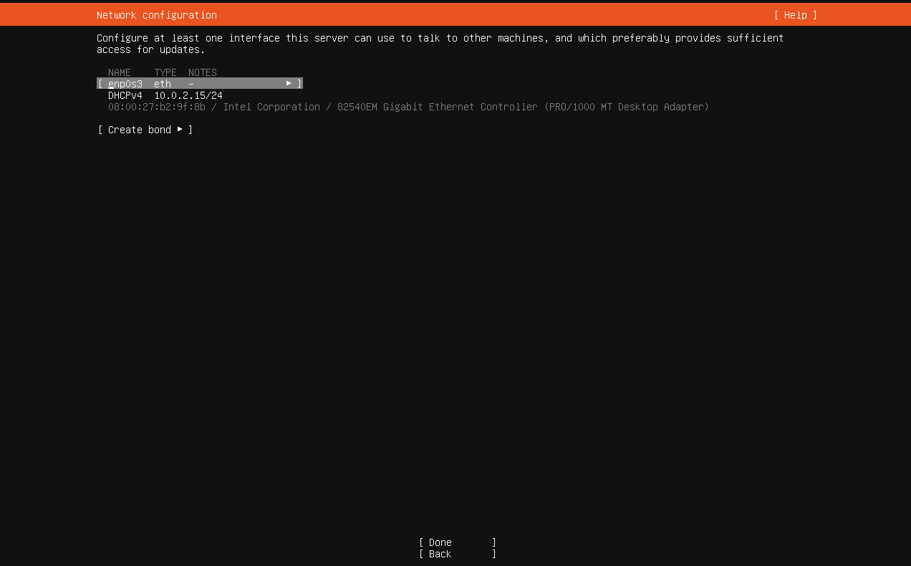
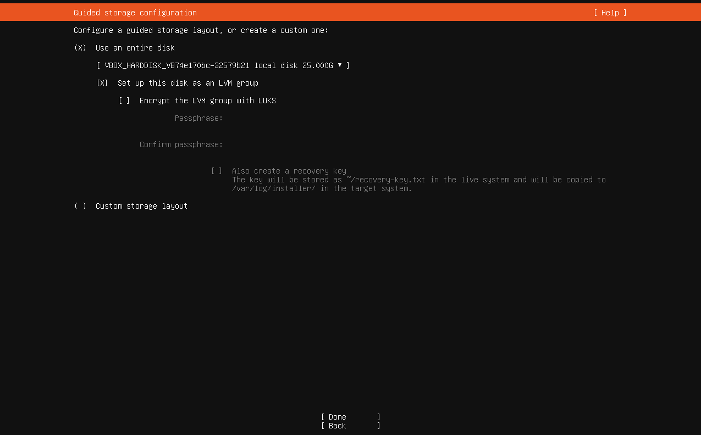
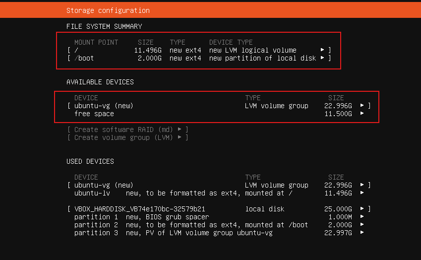
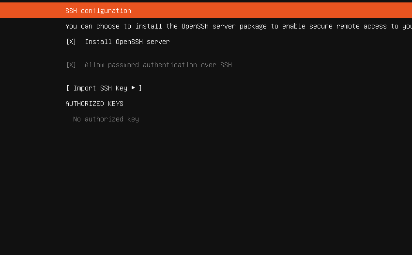
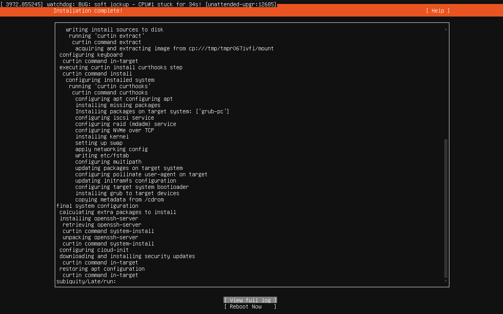

# Ubuntu Nginx Web Server

My first Linux server administration project.

## Project Goal
Install and configure an Ubuntu Server with Nginx
to host a website and learn basic Linux administration.

### Virtual Disk Configuration

I created a 25 GB virtual hard disk using the VDI format.

I chose dynamically allocated storage so the virtual disk
only uses the space it needs on my actual computer,
instead of reserving all 25 GB immediately.

## Network Configuration
Ubuntu automatically received the IP adress 10.0.2.15/24 thought DHCP.

The server uses a virutal network adapter provided by te VirutalBox with NAT networking.

This allows the server to access the internet for updates and software installations.

## Storage Configuration

For this server I'll be using the full capacity of our virutal disk of 25 GB for my Ubuntu server.

I picked LVM (Logical Volume Manager) because it makes it easier to manage and resize storage volumes later.

I kept the default guided storage layout because
this is a local web server lab.

## Understanding the Linux Storage Layout

After configuring the virtual disk Ubuntu showed me how the 25 GB of storage would be organized.

**Here's what I learned:**

- / (Root): The main filesystem where Ubuntu, installed software, configurations and other files are stored.

- /boot: Contains the files Linux needs to start up.

- ext4: The filesystem Ubuntu uses to organize and store files.

- LVM (Logical Volume Manager): Allows storage to be managed more flexibly, including expanding logical volumes later.

**My storage configuration:**

- *Root (/): 11.5 GB*

- *Boot (/boot): 2 GB*

- *Unallocated LVM space: 11.5 GB*

What I found interesting is that Ubuntu didn't assign all 25 GB to the root filesystem. Instead, it left some space available inside the LVM volume group, which can be used to expand storage later.

**My analogy:** The disk is the warehouse, Root is the main storage, /boot contains the startup instructions, and LVM lets me reorganize the available space when needed.

One thing to keep in mind: The 11.5 GB of free space is not unused disk space, but rather unallocated within the LVM (Logical Volume Manager).

## SSH Configuration

I enabled OpenSSH Server during installation so I
can remotely manage my Ubuntu Server through a terminal.

SSH uses encrypted connections, normally over TCP
port 22. This allows administrators to manage servers
without needing physical access to them.

For this local lab, I enabled password authentication.
I plan to practice SSH key authentication later.

### Ubuntu Server Installation

I successfully installed Ubuntu Server 24.04 LTS
with OpenSSH and security updates.

During the installation I noticed a CPU warning in the logs. The installation completed
so my next step is to reboot and verify that
the server runs correctly.

## Troubleshooting

After Ubuntu finished installing I encountered a "Failed unmouting cdrom.mount" error.

